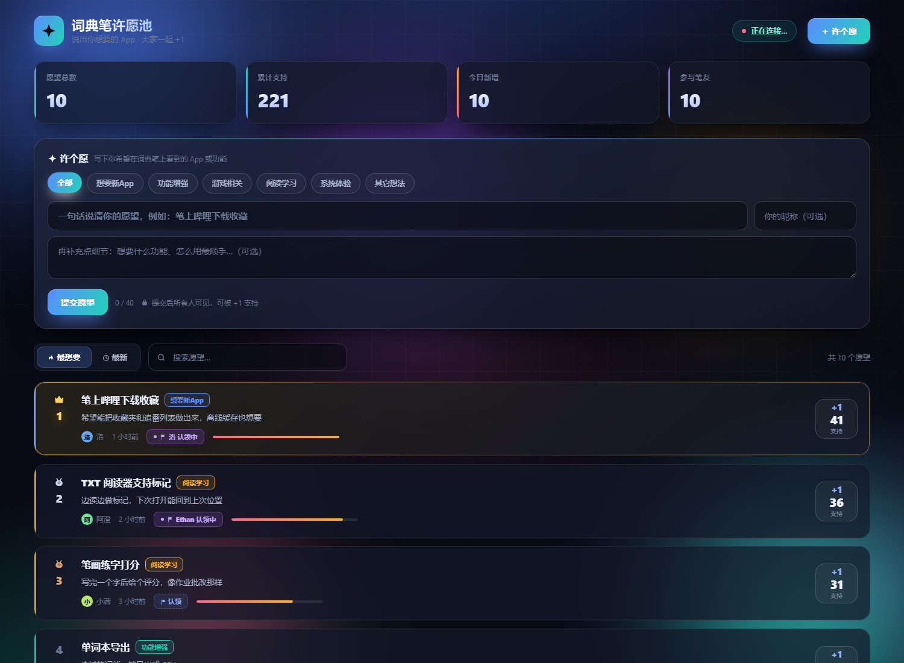
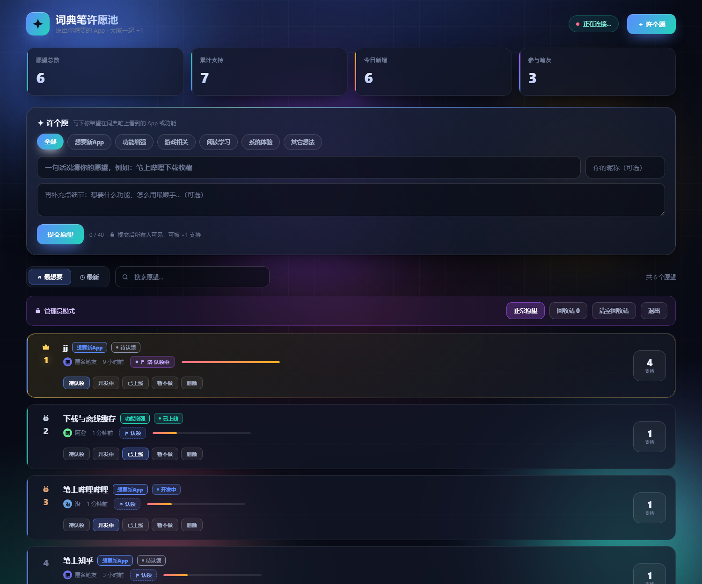
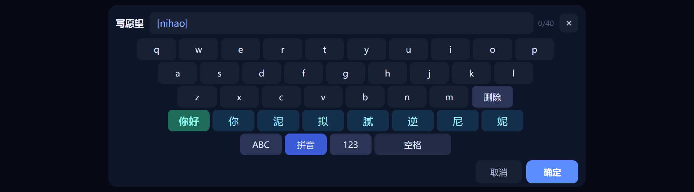
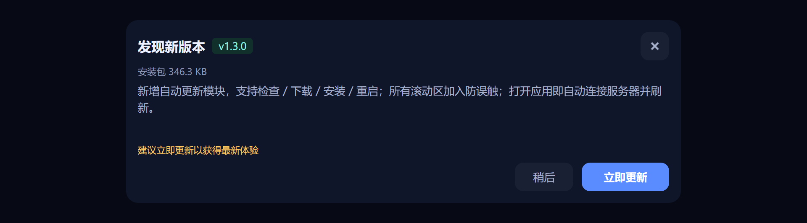
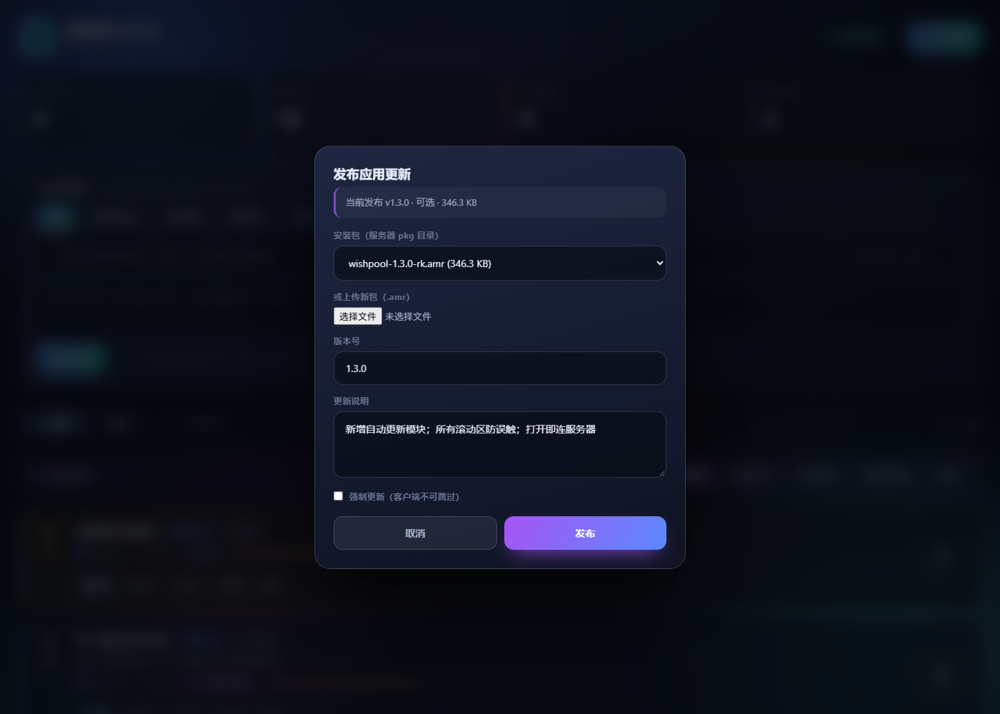

<div align="center">

# 许愿池 · Wish Pool

**面向有道词典笔的愿望收集与认领平台**

许个愿 → 大家一起 +1 → 开发者认领 → 上线

[功能](#功能) · [截图](#截图) · [架构](#架构) · [快速开始](#快速开始) · [接口](#接口) · [许可](#许可)

</div>

---

## 这是什么

一块跑在**有道词典笔**上的「许愿池」：任何人可以提交自己想要的 App 或功能，
所有人可见、可以给任意愿望 **+1** 支持，列表按支持度实时排序；
开发者可以**认领**愿望表示「这个我来做」，认领会把昵称记录到服务端。

配套一个**大屏实时面板**，笔上提交的愿望几秒内出现在面板上。

整个系统由三部分组成，全部零第三方依赖（服务端）+ 零构建（面板）：

| 组件 | 说明 |
|---|---|
| `server/` | Python 3 标准库：SQLite + HTTP + SSE 实时推送，单文件服务端 |
| `server/panel.html` | 单文件大屏面板，暗色玻璃拟态，SSE 实时热榜 |
| `client/` | 词典笔端 App（Falcon MiniApp / Vue2 + QuickJS） |

## 功能

### 愿望
- 提交愿望（标题 / 说明 / 昵称 / 分类），所有人可见
- **+1 支持**：按设备 SN 或客户端 ID 去重，一人一票、可取消
- 按支持度排序（「最想要」）或按时间（「最新」）
- 6 个分类筛选 + 关键词搜索

### 认领（需管理密码）
- 认领 / 释放都由**服务端强制校验**管理密码，不是前端遮罩
- 认领时记录昵称，写入 `wishes.claimed_by` 与 `claims` 审计表
- 一个愿望同时只能有一个有效认领，重复认领幂等
- 认领状态实时推送到面板与其它的笔

### 愿望状态
四档，面板后台随时切换，客户端只读展示：
`待认领 open` / `开发中 doing` / `已上线 done` / `暂不做 rejected`

### 管理后台
面板右上角「管理」登录后：
- 改状态（一键四档切换）
- 删除 → 回收站 → 恢复 / 彻底删除 / 清空回收站
- **发布更新**：上传 `.amr`、填版本与说明、勾选强制更新

### 笔端
- **内置输入法**：ABC / 拼音 / 123 三模式，拼音带词库候选
  （万象拼音 414 音节 + 19790 条词，全部离线）
- **滚动防误触**：滑动时不会误触发卡片与按钮
- **打开即连服务器**：失败自动重试，并自动检查更新
- **自动更新**：检查 → 下载 → 安装 → 重启，全自动（见下）

## 截图

<table>
<tr>
<td width="50%"><br><sub>大屏面板：实时热榜</sub></td>
<td width="50%"><br><sub>管理后台：改状态 / 删除 / 回收站</sub></td>
</tr>
<tr>
<td><br><sub>笔端：按支持度排序</sub></td>
<td><br><sub>笔端：内置拼音输入法</sub></td>
</tr>
<tr>
<td><br><sub>笔端：更新弹窗</sub></td>
<td><br><sub>面板：发布更新</sub></td>
</tr>
</table>

## 架构

```
┌──────────────┐   HTTP/JSON   ┌──────────────────┐
│  词典笔 App   │ ────────────► │  wish_server.py   │
│ Falcon/Vue2  │ ◄──────────── │  SQLite + HTTP    │
│ QuickJS      │   轮询 5s     │  SSE 广播          │
└──────────────┘               └──────────────────┘
        │                               ▲
        │ 原生模块 updater               │ SSE
        │ download/install/start         │
        ▼                               │
   /userdisk/*.amr              ┌───────┴────────┐
                                │  panel.html    │
                                │  大屏实时面板   │
                                └────────────────┘
```

**写操作全部走 `GET + query`** —— 这是平台限制：词典笔真机上原生 `http` 的
`POST body` 会丢，所以投票 / 提交 / 认领 / 日志上报都是 GET。面板则用 POST。

## 快速开始

### 1. 服务端

```bash
cd server
python3 wish_server.py
```

默认监听 `0.0.0.0:17613`，首次启动自动生成管理密码 `admin_pass.txt`。

```bash
curl http://127.0.0.1:17613/healthz
# {"ok":true,...}
```

### 2. 面板

浏览器打开 `http://你的服务器:17613/` 就是大屏面板；
右上「管理」用密码登录后是后台。

### 3. 笔端

```bash
cd client
npm install                                    # 装 aiot-vue-cli + falcon-ui
# 改 src/services/api.js 里的 ENDPOINTS 指向你的服务器
npm run build:prod                             # 产出 *.amr
```

把 `.amr` 拷到笔上安装：

```bash
adb push 8001865309000101.x.y.z.amr /userdisk/
adb shell miniapp_cli install /userdisk/8001865309000101.x.y.z.amr
```

详细步骤见 [docs/部署.md](docs/部署.md)。

## 自动更新

笔端固件不提供 JS 层的「安装应用」接口，官方 `downloadFile` 在该固件上还会挂住，
所以走一个自研原生模块 `libs/libjsapi_updater.so`（源码见 `native/`）：

```js
// 动态 require，禁止静态 import（缺 .so 时会整页黑屏）
const updater = require('updater')
updater.download(url, '/userdisk/wishpool/x.amr')   // 0 = 成功
updater.install('/userdisk/wishpool/x.amr')         // 0 = 成功
updater.start('8001865309000101')                   // 重启
```

流程：`GET /app-update` → 弹窗 → 下载 → 安装 → 重启。
强制更新时弹窗不可跳过。原生不可用则降级为「显示直链，手动安装」。

> 首次需手动安装一次带该模块的包，此后即可全自动更新。

## 接口

完整说明见 [docs/API.md](docs/API.md)。核心几个：

| 方法 | 路径 | 说明 |
|---|---|---|
| GET | `/api/wishes?sort=&category=&q=&status=` | 愿望列表 |
| GET | `/api/wish/add?title=&category=&client_id=` | 提交愿望 |
| GET | `/api/wish/{id}/vote?client_id=` | +1（幂等） |
| GET | `/api/wish/{id}/unvote?client_id=` | 取消 +1 |
| GET | `/api/wish/{id}/claim?nick=&client_id=` | 认领（需管理密码） |
| GET | `/api/wish/{id}/release?client_id=` | 释放认领（需管理密码） |
| GET | `/api/stream` | SSE 实时流 |
| GET | `/app-update?version=&platform=` | 检查更新 |

管理接口需 `X-Admin-Pass` 头：改状态、删除、恢复、清空回收站、发布更新、上传包。

## 配置

| 环境变量 | 默认 | 说明 |
|---|---|---|
| `PORT` | `17613` | 监听端口，支持 `17613,8080` 多端口 |
| `DB_PATH` | `./wish.db` | SQLite 路径 |
| `PKG_DIR` | `./pkg` | 安装包目录 |
| `ADMIN_PASS` | 空 | 管理密码，为空则自动生成 |
| `RATE_SUBMIT` / `RATE_VOTE` / `RATE_CLAIM` | `20` / `240` / `60` | 每 IP 每 60s 限流 |

## 文档

| 文档 | 内容 |
|---|---|
| [docs/交接.md](docs/交接.md) | **项目交接**：架构、决策理由、平台踩坑清单、排错、待办 |
| [docs/API.md](docs/API.md) | 全部接口、参数、返回、限流 |
| [docs/部署.md](docs/部署.md) | 从零部署、Nginx、备份、排错 |
| [native/README.md](native/README.md) | 原生更新模块的由来与编译方式 |

> 初次接手建议按 `交接.md` 第 13 节的路线走一遍。

## 许可

代码以 [MIT](LICENSE) 发布。第三方内容见 [NOTICE.md](NOTICE.md)：

- 拼音数据来自 [万象拼音](https://github.com/amzxyz/rime-wanxiang)，**CC-BY-4.0**
- 原生模块源码与预编译产物随附于 `native/`

---

<div align="center"><sub>为词典笔做的一点小事</sub></div>
